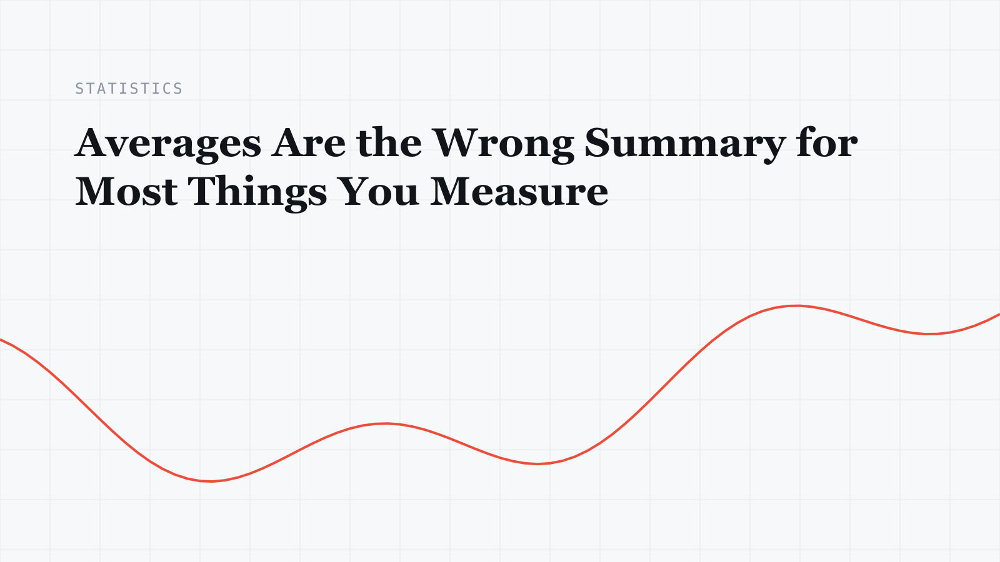

Copy this file to start a new article. The filename becomes the URL, so `my-new-post.md` publishes at `/writing/my-new-post/`. Set `draft: false` when it's ready to go live.

## A section heading

Body text sits at the same size and line height as the full story page. Here's **bold text**, *italic text*, a [link to the about page](/about/), and some `inline code`.

### A smaller heading

- An unordered list item
- Another item, long enough to wrap onto a second line so you can see how the indent holds up
- A third item

1. An ordered list item
2. A second step
3. A third step

> A pull quote. Use it for the one sentence you most want a reader to remember.

```python
import numpy as np

def zscore(x: np.ndarray) -> np.ndarray:
    """Standardize against the sample mean and deviation."""
    return (x - x.mean()) / x.std(ddof=1)
```

| Method | Strength | Where it stops holding |
| --- | --- | --- |
| Fixed threshold | Simple, explainable | Seasonal signals |
| Peer-group baseline | Local sensitivity | Sparse peer groups |

## Math

Inline math sits in the sentence: the sample mean $\bar{x} = \frac{1}{n}\sum_{i=1}^{n} x_i$ is unbiased. Display math gets its own line:

$$
\hat{\beta} = (X^\top X)^{-1} X^\top y
$$

Write a literal dollar sign as `\$`, so \$1,000 stays text.

## Figures

An image on its own line becomes a figure. The quoted title after the path becomes the caption, and the alt text describes the image for screen readers.



---

A closing paragraph after a divider.
