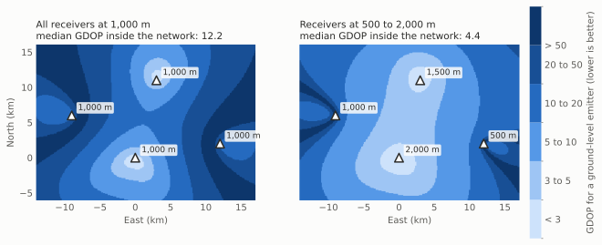

## The Midnight Launch

It is 2:47 a.m. local time. An infrared satellite detects a thermal bloom over a contested region. The signature fits a ballistic missile launch: a rapid temperature rise, a characteristic exhaust plume, and a sustained burn of 47 seconds. The classifier assigns it 70% confidence.

An operator 8,000 miles away sees a red icon inside a 50-kilometer uncertainty circle. The circle covers three military installations, two industrial facilities, and a power plant. Which one launched? Where should interceptors go? The thermal signature alone cannot answer either question with the precision a response requires.

Three seconds later, a radio frequency (RF) geolocation system locks onto command signals from the same region. Time difference of arrival (TDOA) measurements from four ground stations place the emitter within ±50 meters at 80% confidence. The RF system knows where the emitter is. It has no idea what produced the heat. Is this the same event?

A fusion algorithm settles that question first. The RF fix falls inside the infrared uncertainty region and the timing matches, so the tracker associates both measurements with a single track. From there it folds in each new TDOA fix as it arrives, about ten per second, and weights every measurement by its uncertainty. One second later, the operator's screen reads: launch site fixed to ±15 meters, 95% confidence, liquid-fueled medium-range ballistic missile.

Four seconds separate the first detection from actionable intelligence. In that span, the picture moves from 70% confidence across 50 kilometers to 95% confidence within 15 meters. That is the difference between hesitation and a decision.

The scenario illustrates a basic fact of intelligence, surveillance, and reconnaissance (ISR): no single sensor sees the whole event. The infrared satellite knows what happened and when. The RF network knows where. Fusion produces an answer that neither can produce alone.

This article covers the mathematics, algorithms, and practical tradeoffs behind that answer, drawing on Locant, a multi-sensor fusion platform I built to work through these problems end to end.

## What Each Sensor Cannot See

Every sensing modality trades one kind of knowledge for another.

**Overhead Persistent Infrared (OPIR)** satellites detect thermal events anywhere on the globe, within seconds. A missile launch produces a distinctive signature visible from orbit. But a single infrared detection fixes position only coarsely, to within kilometers, which falls far short of what a response needs.

**RF geolocation** systems locate emitters precisely from timing and frequency measurements. They depend entirely on the target transmitting. A silent threat stays invisible to them, and they cannot say what kind of object holds the emitter.

| | OPIR | RF geolocation |
|---|---|---|
| Detects | Thermal events, anywhere | Active emitters only |
| Position | Kilometers | Tens of meters |
| Identifies the event | Yes, from the signature | No |
| Fails when | The event is thermally faint | The target stays silent |

The obvious approach reports both outputs side by side and leaves the correlation to analysts. That adds delay and invites error at exactly the moment both are expensive. Fusion does the correlation in the algorithm, then combines the measurements so that each sensor contributes what it knows best. The rest of this article explains how.

## The Architecture of Multi-Sensor Fusion

A fusion system answers three questions in sequence. Which measurements belong to which target? How should those measurements combine? How should the system carry its estimate forward between measurements?

### 1. Data Association: Matching Measurements to Tracks

With several sensors observing several targets, the first problem is assignment. Each incoming measurement must go to the right track, or to a new one.

The standard tool is the Mahalanobis distance between a measurement and a track's prediction:

$$
d^2 = \big(z - h(\hat{x})\big)^\top S^{-1} \big(z - h(\hat{x})\big)
$$

Here $z$ is the measurement, $h(\hat{x})$ is the measurement the track predicts, and $S = HPH^\top + R$ is the innovation covariance, which combines the track's uncertainty $P$ with the sensor's measurement noise $R$.

Euclidean distance treats every meter the same. Mahalanobis distance scales each direction by the uncertainty in that direction, so a 100-meter offset can be routine for one sensor and impossible for another. A measurement passes the gate when $d^2$ falls below a threshold drawn from a chi-square distribution. For a two-dimensional position at 99% probability, that threshold is about 9.2.

Because the threshold applies to $d^2$, the gate's physical footprint follows the track's covariance. A confident track gets a small gate, and an uncertain one gets a large gate. In Locant, that works out to roughly 500 meters for high-confidence tracks and roughly 2,000 meters for uncertain ones.

Three design choices remain. The threshold itself trades missed associations (too tight) against false ones (too loose). The assignment method trades speed (nearest neighbor) against accuracy (global optimization across all tracks at once). And the system needs a rule for ambiguity, when one measurement falls inside several gates.

### 2. Measurement Fusion: Combining Information

Once measurements belong to the same track, the system combines them by weighting each with its inverse covariance, which is its information matrix. When the two sensors' errors are independent, the fused estimate is:

$$
P_f = \left(P_1^{-1} + P_2^{-1}\right)^{-1}, \qquad
\hat{x}_f = P_f \left(P_1^{-1}\hat{x}_1 + P_2^{-1}\hat{x}_2\right)
$$

In code:

```python
import numpy as np

I_1 = np.linalg.inv(P_1)   # OPIR information
I_2 = np.linalg.inv(P_2)   # RF information

P_fused = np.linalg.inv(I_1 + I_2)
x_fused = P_fused @ (I_1 @ x_1 + I_2 @ x_2)
```

Information adds. The fused covariance is never larger than either input, and a precise measurement dominates an imprecise one. Under independent Gaussian errors, this is the minimum-variance combination. It also explains the opening scenario: a 50-kilometer infrared fix barely moves a 50-meter RF fix, so the infrared contribution lies in association and classification rather than position. The tightening from ±50 to ±15 meters comes from many independent RF fixes, each adding its own information to the track.

The independence assumption fails more often than it appears to. If two receivers share a common time reference, their timing errors correlate, and the formula above then reports more confidence than the data supports. Covariance intersection (Julier and Uhlmann, 1997) handles unknown correlation conservatively:

$$
P_{CI}^{-1} = \omega P_1^{-1} + (1-\omega) P_2^{-1}, \qquad
\hat{x}_{CI} = P_{CI}\left(\omega P_1^{-1}\hat{x}_1 + (1-\omega) P_2^{-1}\hat{x}_2\right)
$$

The weight $\omega \in [0, 1]$ usually minimizes the trace or determinant of $P_{CI}$. The result stays consistent for any correlation between the inputs. The cost is a wider fused covariance, and an honest wide estimate beats a confident wrong one.

### 3. Track Management: Carrying State Through Time

Detections come and go. Sensors drop out. Targets maneuver. A Kalman filter carries the estimate forward between measurements and corrects it when one arrives.

The prediction step propagates the state and grows its uncertainty:

$$
\hat{x}_{k|k-1} = F\hat{x}_{k-1}, \qquad P_{k|k-1} = FP_{k-1}F^\top + Q
$$

The update step blends the prediction with a new measurement:

$$
K = P_{k|k-1}H^\top S^{-1}, \qquad
\hat{x}_k = \hat{x}_{k|k-1} + K\left(z_k - H\hat{x}_{k|k-1}\right), \qquad
P_k = (I - KH)P_{k|k-1}
$$

$F$ is the motion model, $Q$ the process noise that captures motion uncertainty, and $H$ the measurement matrix that maps state to observation. For nonlinear measurements such as TDOA, the extended Kalman filter replaces $H\hat{x}$ with $h(\hat{x})$ and uses its Jacobian for $H$.

The equations are standard. The judgment lives in the tuning. Set process noise too low and the filter trusts its motion model over the evidence; set it too high and it chases every noisy measurement. Coasting logic decides how long a track survives without updates. A quality score decides when a track is reliable enough to act on.

Locant scores each track on three factors: classifier confidence on a 0 to 1 scale, a precision term that falls as circular error probable (CEP) grows, and sensor diversity, which separates infrared-only tracks from multi-sensor ones. Tracks above 0.7 count as high quality for operational use.

## RF Geolocation: TDOA and FDOA

RF geolocation deserves a closer look. Imaging sensors observe position directly. RF systems infer it from when and at what frequency a signal arrives.

### Time Difference of Arrival

When an emitter transmits, receivers at different positions hear the signal at different times. Each pair of receivers defines a hyperbolic surface of possible emitter locations:

$$
\tau_{ij} = \frac{\lVert r - s_i \rVert - \lVert r - s_j \rVert}{c}
$$

Here $r$ is the unknown emitter position, $s_i$ and $s_j$ are the known receiver positions, and $c$ is the speed of light.

$N$ receivers form $N(N-1)/2$ pairs, but only $N-1$ of those differences are independent; the rest are linear combinations of them. Four receivers yield three independent TDOAs, exactly the minimum for a three-dimensional fix, with no redundancy. Redundancy requires a fifth receiver, an added measurement such as FDOA, or a constraint such as a terrain model for an emitter known to sit on the ground.

The equations are nonlinear, so the solver minimizes weighted residuals iteratively:

```python
import numpy as np
from scipy.optimize import least_squares

C = 299_792_458.0  # speed of light, m/s

def residuals(r, measurements, sensors):
    res = []
    for m in measurements:
        s_i, s_j = sensors[m.i], sensors[m.j]
        predicted = (np.linalg.norm(r - s_i) - np.linalg.norm(r - s_j)) / C
        res.append((m.tdoa - predicted) / m.sigma)
    return res

result = least_squares(residuals, x0, args=(measurements, sensors), method="lm")
```

Iterative solvers need a reasonable starting point. Closed-form estimators, such as the one Chan and Ho published in 1994, supply one.

### Frequency Difference of Arrival

A moving emitter produces a different Doppler shift at each receiver. For stationary receivers, the frequency difference depends on the emitter's velocity:

$$
f_{ij} = \frac{f_0}{c}\left(v \cdot u_j - v \cdot u_i\right)
$$

Here $v$ is the emitter velocity, $u_i$ and $u_j$ are unit vectors from the emitter toward each receiver, and $f_0$ is the carrier frequency. Moving receivers require the relative velocity instead. FDOA complements TDOA, and together they support joint estimation of position and velocity.

### Geometric Dilution of Precision

The same measurement noise can produce very different position errors depending on where the receivers sit. Geometric dilution of precision (GDOP) captures that effect:

$$
\mathrm{GDOP} = \sqrt{\operatorname{tr}\left[\left(H^\top H\right)^{-1}\right]}
$$

For TDOA, each row of $H$ is the difference between the unit vectors toward two receivers. Low GDOP means the hyperbolas cross at steep angles and pin the emitter down. High GDOP means they cross at shallow angles and smear it out.

A network with every receiver at the same altitude produces poor three-dimensional geometry. When the receivers sit at nearly the same height, the vertical components of their unit vectors barely differ, and altitude becomes almost unobservable. The figure shows the effect for four receivers spread across about 20 kilometers, solving for a ground-level emitter in three dimensions.



*Same horizontal layout, different altitudes. Raising and lowering receivers cuts the median GDOP inside the network from 12.2 to 4.4. Illustrative geometry, computed for this article.*

Two caveats sharpen the lesson. First, which receiver sits at which altitude matters as much as the spread. With the same four altitudes assigned to different positions, the median GDOP in this layout rises to about 43, worse than the flat network. Second, altitude diversity matters only when the solver must estimate altitude. If a terrain model pins a ground emitter to the surface, the problem drops to two dimensions and the flat network performs just as well.

Locant models a deployment with vertical diversity:

- Ground station at 500 m elevation
- Low-altitude ISR platform at 1,000 m
- Medium-altitude platform at 1,500 m
- High-altitude ISR platform at 2,000 m

In Locant's geometry, this configuration holds GDOP between 2 and 5, while a flat version of the same network exceeds 80. Position errors fall to 10 to 20 meters, compared with more than 500 meters for the flat case. The figure uses a different layout, so its numbers differ, but the direction holds.

## Defense Applications

### Missile Defense

Early warning systems must detect, classify, and track a ballistic missile within seconds. OPIR provides the first detection from the exhaust plume but cannot fix the launch site precisely enough for a response. Fusing OPIR with RF geolocation of associated command signals lets a system detect the launch within seconds, locate the site to within 50 meters, classify the missile from its infrared signature and emitter characteristics, predict its trajectory with a physics-based motion model, and cue interceptors from a fused track in under five seconds. Neither sensor alone closes the detect, track, and engage loop that fast.

### Counter-UAS Operations

Small unmanned aircraft systems are thermally faint, transmit intermittently, and maneuver hard, so each sensor sees only part of their flight. Electro-optical sensors detect them visually. RF systems locate them while they transmit. Acoustic sensors cover silent stretches, and radar provides continuous tracking. When a drone stops transmitting, the tracker coasts on physical limits: a quadcopter moving at 15 m/s cannot suddenly appear two kilometers away.

### Signals Intelligence

An adversary's emissions reveal intent. Rising traffic can signal offensive preparation, relocated command nodes can signal repositioning, and new emitter types can signal a new capability. Fusing signals intelligence with other sources builds an electronic order of battle. SIGINT contributes emitter types, frequencies, and transmission patterns. OPIR contributes heat from generator trucks and their power demands. Synthetic aperture radar contributes physical infrastructure such as antennas and vehicles. Human intelligence contributes the identities of key personnel. Together they describe not only where an emitter sits but what it is, who operates it, and why.

## Case Study: Locant

To test these ideas end to end, I built Locant, a multi-sensor fusion platform that runs on simulated data.

**Data generation.** Physics-based OPIR signal synthesis covers five event classes: missile launches, explosions, wildfires, aircraft, and background. RF generation covers radar and communications emitters. The training set holds more than 10,000 labeled samples.

**OPIR processing.** Detection combines temporal differencing, anomaly detection, and rise-time analysis. A one-dimensional CNN in PyTorch classifies events into the five classes. A multi-target Kalman tracker maintains state.

**Fusion.** A hybrid TDOA/FDOA solver handles geolocation. Mahalanobis gating handles association. Covariance-weighted fusion combines measurements, and the track quality score ranks the results.

### Results

On simulated scenarios, the three configurations performed as follows.

**OPIR only.** Detection rate of 92% and classification accuracy near 90%. Position information was coarse, at kilometer scale.

**RF only.** Geolocation accuracy of 13 meters from a four-receiver network at GDOP 3.2, with velocity accuracy of ±8 m/s. Coverage dropped during silent periods, jamming, and terrain masking.

**Fused.** Detection rate of 95%, since cross-cueing recovered events that either sensor missed alone. Position accuracy of 15 meters and classification accuracy above 90%. Average track quality of 0.72.

The fused position figure sits slightly above the RF-only figure because it averages over every track, including stretches where the tracker coasts through RF gaps. The RF-only number counts only moments when the emitter transmits. Across matched tracks, those combining OPIR and RF showed 40% lower position uncertainty and 25% higher confidence than single-sensor tracks.

### Lessons Learned

**Geometry sets the ceiling.** My first network placed every receiver at 1,000 meters. GDOP exceeded 80 and position errors passed 500 meters. The algorithms ran correctly and still produced unusable answers. Adding vertical diversity, from 500 to 2,000 meters, brought GDOP down to between 2 and 5 and errors down to 10 to 20 meters. No algorithm compensates for poor geometry.

**Gates must scale with uncertainty.** The first version used fixed-radius gates. Confident tracks missed valid measurements during maneuvers, and uncertain tracks absorbed spurious detections. Gates scaled to each track's covariance improved association accuracy by 30%.

**Quality scores make tracks usable.** Early on, the system presented every track the same way, and operators could not tell a strong multi-sensor track from a weak single-sensor coast. The composite quality score fixed that. Filtering at 0.7 removed 80% of false tracks while keeping 95% of true ones.

## Operational Considerations

### Latency

A missile defense system cannot wait ten seconds for an answer. Tracks process independently, so the work parallelizes cleanly. An extended Kalman filter costs far less than unscented or particle filters and is usually accurate enough. Gating prunes most candidate pairings before the expensive assignment step; with spatial indexing, association cost grows close to linearly with the number of tracks instead of quadratically. Update rates follow the mission, around 1 Hz for strategic tracking and 10 Hz for tactical scenarios. For the same reason, Locant solves the nonlinear least-squares problem with Levenberg-Marquardt, which converges quickly from a good starting point, rather than with a slower global search.

### Uncertainty Quantification

A position without a confidence bound is incomplete. "The emitter is at X, Y, Z" needs "±50 meters at 95% confidence" beside it. Locant reports three measures: CEP, the radius containing the true position half the time; the full covariance ellipsoid, which shows uncertainty in three dimensions; and GDOP, which predicts accuracy from geometry before any measurement arrives. Together they tell a commander when a track can bear a decision.

### Graceful Degradation

Sensors fail, links drop, and adversaries jam. A resilient fusion system coasts tracks on physics-based prediction during gaps, lowers their confidence as the gaps lengthen, and uses each sensor to cue the others, letting OPIR direct RF collection and the reverse. The system degrades in steps rather than all at once, and it keeps producing usable estimates as it loses inputs.

## Where Fusion Goes Next

**Learned association.** Today's association relies on hand-built rules: Mahalanobis gates and fixed thresholds. Models trained on operational data could learn association strategies that adapt to context and to adversary tactics, for example attention-based models that weight sensor contributions by scenario.

**Predictive fusion.** Current systems react to measurements as they arrive. A predictive system anticipates them. If a track heads toward a coverage gap, it can raise the sampling rate beforehand and task backup sensors.

**Semantic fusion.** Kinematics answers where a target is. Full situational awareness also needs what it is, what it is doing, and how dangerous it is. That requires fusing across imaging, SIGINT, human intelligence, and open sources.

**Distributed fusion.** Central fusion creates bottlenecks and single points of failure. Distributed architectures process at the edge, survive node loss, and scale as sensors join. Their hard problem is consistency: when nodes exchange fused estimates, the same information can circulate and count twice. Covariance intersection, which tolerates unknown correlation, serves as one of the main tools for preventing that.

## Conclusion

Modern defense systems cannot treat fusion as optional, because no single sensor provides complete information. The technical problems are real: nonlinear estimation for TDOA and FDOA, unknown correlations between sensors, sub-second update cycles, and the constant pressure of outages and jamming.

The return justifies the effort. Well-designed fusion delivers 10 to 20 meter geolocation where infrared alone offers kilometers, quantified uncertainty that supports decisions, graceful behavior when sensors fail, and a picture complete enough to act on quickly.

Locant runs the full chain on simulated data, from raw sensor signals through classification, geolocation, fusion, and track management. It demonstrates the techniques; it is not a fielded system. The lessons still carry over to any system that must turn partial measurements into a decision. As sensors multiply and countermeasures improve, more of the advantage will come from how measurements combine than from any single sensor.

## References

1. Bar-Shalom, Y., Li, X. R., and Kirubarajan, T. *Estimation with Applications to Tracking and Navigation.* Wiley-Interscience, 2001.
2. Blackman, S., and Popoli, R. *Design and Analysis of Modern Tracking Systems.* Artech House, 1999.
3. Chan, Y. T., and Ho, K. C. "A Simple and Efficient Estimator for Hyperbolic Location." *IEEE Transactions on Signal Processing*, 1994.
4. Ho, K. C., and Xu, W. "An Accurate Algebraic Solution for Moving Source Location Using TDOA and FDOA Measurements." *IEEE Transactions on Signal Processing*, 2004.
5. Julier, S. J., and Uhlmann, J. K. "A Non-divergent Estimation Algorithm in the Presence of Unknown Correlations." *Proceedings of the American Control Conference*, 1997.
6. Kay, S. M. *Fundamentals of Statistical Signal Processing: Detection Theory.* Prentice Hall, 1998.
7. Mahler, R. *Statistical Multisource-Multitarget Information Fusion.* Artech House, 2007.

---

*Locant is a personal project built on simulated data. The code is available at [github.com/michael-gurule/locant](https://www.github.com/michael-gurule/locant). An earlier version of this article appeared on Medium in December 2025 as "Multi-Sensor Fusion for Defense Applications."*
